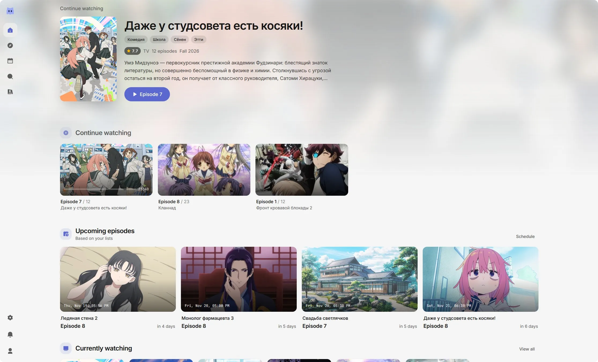
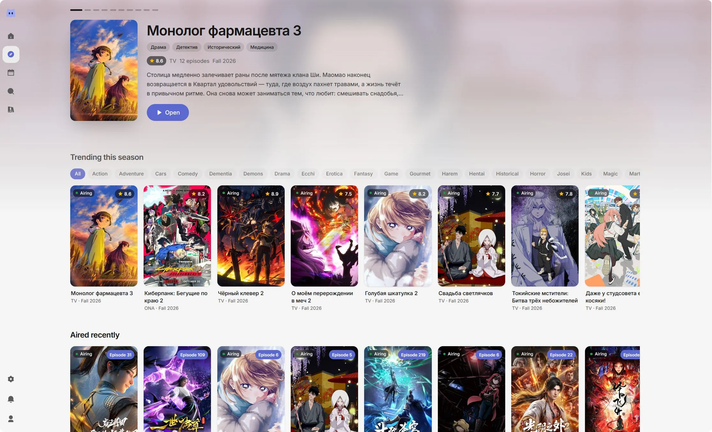

<div align="center">


# yoru

**A self-hosted anime tracker and player for you and the people you invite.**

Lists, a player with subtitles or dubs, a release calendar, friends and a shared feed.<br>
Titles and video come from the providers you pick and put in order, and extensions add your own.

[](https://github.com/anivire/yoru/commits/master)
[](#getting-started)
[](#features)

[Features](#features) · [Getting started](#getting-started) · [Dokploy](docs/deploy/dokploy.md) · [Coolify](docs/deploy/coolify.md) · [Sources](#sources) · [Extensions](docs/extensions/README.md)

</div>






## Features

**Watch**
- Player with video from Anime365, AniLibria, Kodik or your own extensions. If the first source has no episode, the next one is used.
- Subtitles or voice-over, a favourite translation author for each, and playback that resumes where you stopped.
- Skip buttons for openings and endings.
- Watch together (beta): a room where pause, seeking, speed, the episode and the translation stay in sync for everyone.

**Track**
- Lists with statuses, progress, scores, rewatches and notes, in a grid or a table with filters and sorting.
- Notes in Markdown on any anime or episode, private or shared with friends.
- Stats: hours watched, scores, genres, studios, seasons and more.
- Notifications when a new episode gets subtitles or voice-over, and optionally when a new title premieres.
- Import from AniList, Shikimori, MyAnimeList or Seanime; export to JSON, CSV and MAL XML.

**Discover**
- Home page with continue watching, upcoming episodes and a watch activity grid.
- Discover page with seasonal highlights, trending, top rated, upcoming and fresh translations.
- Schedule as a month calendar of aired and upcoming episodes.
- Anime pages with related titles in watch order, characters and voice actors, similar anime, screenshots and the trailer.

**Together**
- Profiles with an avatar (GIFs too), favourites and privacy settings for the list, stats and friends.
- Friends, a feed of their activity, reactions and comments.
- Recommend an anime to a friend or invite friends to a watch together room.
- Blocking, and moderation tools for admins.
- Public read-only link to your list or stats, for people without an account.

**Make it yours**
- Light and dark themes, colour presets, page width, and navigation on any side of the screen.
- Anime titles in romaji, English, Japanese or Russian.
- Interface in Russian and English.
- Interface sounds with several themes (off by default).

## Getting started

You need a server with [Docker](https://docs.docker.com/engine/install/). On **Dokploy** or **Coolify**, follow the step-by-step guide instead: [Dokploy](docs/deploy/dokploy.md), [Coolify](docs/deploy/coolify.md).

**1. Download yoru**

```bash
git clone https://github.com/anivire/yoru.git
cd yoru
cp .env.example .env
```

**2. Set the address and the admin account**

Open `.env` and set three values:

```env
APP_URL=https://yoru.example.com   # the address you will open yoru at
ADMIN_USERNAME=admin               # your login
ADMIN_PASSWORD=a-long-password     # 8 characters or more
```

**3. Start it**

```bash
docker compose up -d --build
```

The first build takes a few minutes. yoru listens on port `3000` inside the container; put it behind your reverse proxy (Caddy, Traefik, nginx), or change `"3000"` to `"3000:3000"` in `docker-compose.yml` to open it at `http://<server>:3000` directly.

**4. Log in and invite people**

Open `APP_URL` and log in with the admin you set. There is no open registration: create invite links under **Management → Invites** and send them to your friends.

That's it. AniLibria video works right away; for Anime365 and Kodik add their tokens under **Management → Sources** (see [Video tokens](#video-tokens)).

### Updating

```bash
git pull
docker compose up -d --build
```

Your data stays in the `yoru-data` volume, and database migrations run on start.

### Good to know

- **No admin in `.env`?** Leave `ADMIN_USERNAME` and `ADMIN_PASSWORD` empty and open the link yoru prints to its log on the first start (`docker compose logs yoru`): `[yoru] no admin yet, create one at …/invite/<code>`.
- **Behind nginx**, forward WebSockets so watch together rooms work: `proxy_http_version 1.1`, `proxy_set_header Upgrade $http_upgrade` and `proxy_set_header Connection "upgrade"`. Caddy and Traefik do it by default.

### Video tokens

- **Anime365** gives video only to accounts with an active subscription. Create an API app on [smotret-anime.app](https://smotret-anime.app), generate an `access_token` and paste it into the Anime365 settings under **Management → Sources** (for everyone) or **Settings → Account** (just for you).
- **Kodik** issues tokens on request; paste it into the Kodik settings. Kodik plays in its own player, so skip buttons and watch together are not available with it.

## Sources

Everything yoru takes from other services is set up in **Management → Sources**. Drag providers into order, switch them on or off and open their settings; changes apply without a restart, and values from `.env` are only the defaults.

| Group | Providers | Used for |
|---|---|---|
| **Primary** | [MyAnimeList](https://myanimelist.net) via [Jikan](https://jikan.moe), [AniList](https://anilist.co), [Shikimori](https://shikimori.io), [Kitsu](https://kitsu.app), [Anime365](https://smotret-anime.app) | Anime data and search. Providers are asked top to bottom until one answers; only MyAnimeList is on by default. |
| **Video** | [Anime365](https://smotret-anime.app), [AniLibria](https://anilibria.top), Kodik | The player, in order. |
| **Features** | Shikimori, AniList, [AniSkip](https://aniskip.com), GitHub | Discover and schedule, screenshots, Russian titles, related titles and characters, skip times, the update check. Each has its own switch. |

## Configuration

All variables are optional except `APP_URL`. Tokens, OAuth keys, API addresses and the GitHub settings can also be changed in the admin panel.

| Variable | Default | What it does |
|---|---|---|
| `APP_URL` | `http://localhost:5173` | Public address, used for invite links, OAuth redirects and secure cookies |
| `ADMIN_USERNAME`, `ADMIN_PASSWORD` | | First admin on an empty database |
| `ANIME365_TOKEN`, `KODIK_TOKEN` | | Shared video tokens; Kodik stays off without one |
| `ANILIST_CLIENT_ID`, `ANILIST_CLIENT_SECRET` | | AniList import |
| `SHIKIMORI_CLIENT_ID`, `SHIKIMORI_CLIENT_SECRET` | | Shikimori import |
| `MAL_CLIENT_ID`, `MAL_CLIENT_SECRET` | | MyAnimeList import |
| `ANIME365_URL`, `JIKAN_URL`, `SHIKIMORI_URL`, `ANILIST_URL`, `KITSU_URL`, `ANILIBRIA_URL`, `KODIK_URL` | public instances | API addresses |
| `GITHUB_REPO`, `GITHUB_BRANCH`, `GITHUB_TOKEN` | `anivire/yoru`, `master` | Update check; the token is only for a private repository |
| `RELEASE_POLL_MINUTES` | `5` | How often new Anime365 releases are checked |
| `SESSION_DAYS` | `30` | Login session lifetime |
| `DATA_DIR`, `DATABASE_PATH` | `./data`, `<DATA_DIR>/yoru.db` | Database location; the Docker image uses `/data` |
| `METADATA_SOURCE` | `jikan` | Legacy: `anime365` puts Anime365 first until the order is saved in the admin panel |

## Development

Requires Node.js 22.12 or newer.

```bash
npm install
npm run dev          # web on localhost:5173, API on port 3000
npm run typecheck    # TypeScript across the workspace
npm run build        # production build
npm run db:generate  # new Drizzle migration after schema changes
```

The API reads `.env` from the repository root and keeps its database in `apps/api/data`. The repository is an Nx workspace: `apps/api` (Hono, Drizzle, SQLite), `apps/web` (React, TanStack Query, Tailwind CSS), `packages/ui` (shared components) and `packages/shared` (types). See [AGENTS.md](AGENTS.md) for code conventions and [DESIGN.md](DESIGN.md) for the design system.
